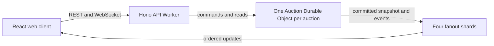

# Gavel Live

Gavel Live is an original, Whatnot-inspired live-commerce auction demo. Sellers run timed auctions, bidders submit
offers, and viewers follow saved changes over WebSockets. The API is built with Cloudflare Workers,
Hono, and Durable Objects; the browser client uses React and TanStack Start.

[Open the live demo](https://gavel-live-web.aranlucas.workers.dev) ·
[Staging API](https://cloudflare-live-auction-staging.aranlucas.workers.dev) ·
[OpenAPI contract](openapi.yaml)

## Try the demo

Open the live demo and choose **Launch instant demo**. It creates a temporary staging auction and
seller, bidder, and viewer credentials. Use **Open another bidder** to join the same auction in a
separate tab with its own bidder identity. Each tab keeps credentials in `sessionStorage`; demo
credentials expire after 15 minutes. The web client also supports a custom API, auction ID, and test
tokens through **Room setup → Advanced setup**.

## Run locally

Requires Node.js 26 or later (see `.node-version`) and the pnpm version declared by the root
`package.json`. From the repository root:

```sh
pnpm install
pnpm dev
```

`pnpm dev` starts the API at `https://api.live-auction.localhost`. In another terminal, start the
web client:

```sh
pnpm --filter gavel-live-web dev
```

The client is available at `https://live-auction.localhost`. Both commands use Portless, which may
ask for permission to bind port 443 and trust a local development certificate on first use. The
client defaults to the staging API. For a local room, select the local API in advanced setup and
configure credentials using [Development](docs/development.md#create-local-test-credentials).

## How it works

Each auction ID maps to one Durable Object. That object stores the auction, bids, ordered event
history, retry records, and closing alarm in SQLite. It serializes commands for that auction and
commits a bid and its event together. Four fanout Durable Objects distribute snapshots and events
to WebSocket clients without deciding whether a bid is valid.



The API verifies signed JWTs and enforces seller, bidder, and viewer roles. A command uses an
`Idempotency-Key` so the client can safely retry after a lost response. See the
[API guide](docs/api.md) for routes, authentication, and realtime recovery.

## Guides

- [Development](docs/development.md): local credentials, checks, and generated files.
- [Deployment](docs/deployment.md): Cloudflare authentication, origins, and demo-key rotation.
- [System design interview](SYSTEM_DESIGN.md): worked correctness cases and architecture tradeoffs.
- [Feature roadmap](ROADMAP.md): proposed releases and acceptance criteria.
- [Web visual concept](apps/web/design/gavel-live-concept.png): the accepted design reference.

## Contributing and security

Changes to `src/model.ts` can affect both the API and web client. Regenerate the checked-in API
contract with `pnpm openapi`, then run `pnpm check` before submitting a change. Never commit private
signing keys, access tokens, `.dev.vars`, or other credentials. See [Security](SECURITY.md) for
credential handling and vulnerability reports.
